### Ciao, sono Riccardo 👋

Ho fondato **[Cortex Studio](https://cortexstudio.it)**: costruiamo software su misura per le PMI.
Prendo un processo che oggi si fa a mano, con fogli Excel, telefonate o dati ricopiati da un gestionale all'altro, e lo trasformo in software che gira da solo.

- 🔧 **Automazioni** fra gestionali, email, SMS e fogli di calcolo
- 🔌 **Integrazioni** con API e strumenti che l'azienda usa già
- 🧠 **AI applicata** a compiti concreti: estrarre dati, scrivere, smistare
- 🚀 Dall'idea alla produzione in tempi brevi, con prodotti che usano clienti veri

---

### 🛠️ Cosa sto costruendo

| Progetto | Cosa fa | Stato |
|---|---|---|
| **[Richiamo](https://richiamo.cortexstudio.it)** | SMS automatici per officine e gommisti: tagliandi, revisioni, cambio gomme. Il cliente torna senza che nessuno debba chiamarlo. | 🟢 Online (c'è una demo) |
| **Macchina contenuti** | Pipeline che studia cosa funziona in una nicchia, genera caroselli e reel (Remotion) e li pubblica tramite la Graph API di Meta. | 🟢 In produzione su [@cortexstudio.it](https://instagram.com/cortexstudio.it) |
| **Lead engine** | Raccoglie aziende da fonti aperte, prepara un dossier con le fonti citate e scrive un primo contatto controllando che non contenga nulla di inventato. | 🟡 Uso interno |
| **Egemonia** | Gioco di strategia nel browser con diplomazia vera, in due scenari: Italia 1850 e Mondo 2026. | 🧪 In sviluppo |

---

### ⚙️ Stack

-14161a?style=flat-square&logo=postgresql&logoColor=ff5a1f)

---

### 📫 Contatti

Hai un processo che ti fa perdere ore ogni settimana? Raccontamelo.

